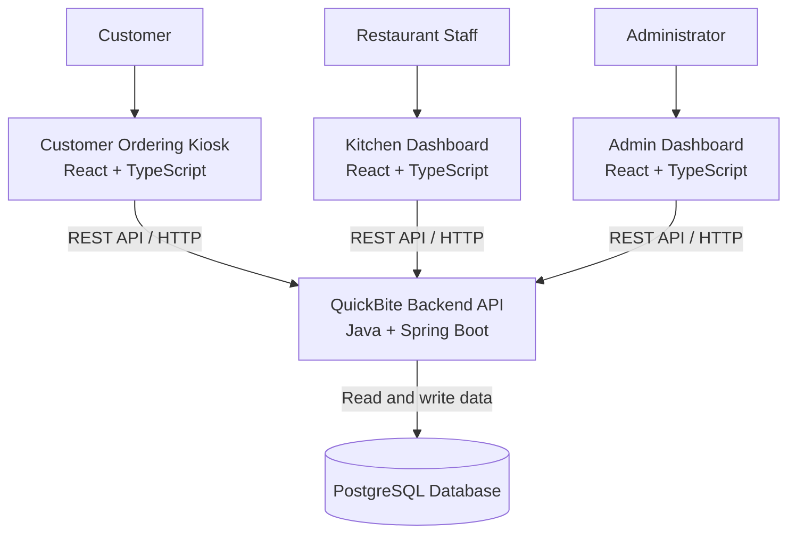

# QuickBite — System Architecture

## Overview

QuickBite is a single-restaurant food ordering and
management system. It consists of three user interfaces,
a shared backend API, and a relational database.

## Architecture Diagram

## Main Components

### 1. Customer Ordering Kiosk
- Displays the restaurant menu.
- Allows customers to add items to a cart.
- Submits orders through the backend API.
- Displays the order ID and order status.

### 2. Kitchen Dashboard
- Retrieves incoming orders from the backend.
- Allows staff to accept orders and update preparation status.
- Displays orders ready for pickup.

### 3. Admin Dashboard
- Allows administrators to manage menu items.
- Updates menu information through the backend API.

### 4. Backend API
- Provides REST endpoints for the three interfaces.
- Applies order and menu business rules.
- Generates unique order identifiers.
- Reads and writes application data.

### 5. Database
- PostgreSQL stores menu items and orders.
- Additional data structures can be introduced as the project grows.

## Order Flow

1. A customer selects menu items and submits an order.
2. The backend validates the request and creates the order.
3. The backend stores the order in PostgreSQL.
4. The kitchen dashboard retrieves the incoming order.
5. Restaurant staff update its preparation status.
6. The customer can check the latest order status.

## Design Principles

- One restaurant, one shared backend.
- Separate frontend repositories for each interface.
- Business logic belongs in the backend.
- The database is accessed through the backend, not directly by the frontend.
- Build the simplest working system first and extend it incrementally.

## Current Scope

This diagram represents the planned logical architecture.
Authentication, payment integration, deployment infrastructure,
and real-time updates will be refined during implementation.
